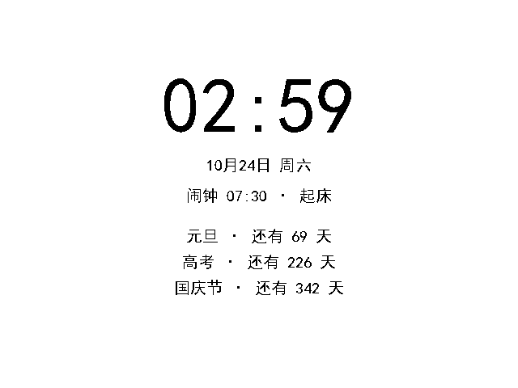

<p align="center">
  
  
  
  
  
</p>

<h1 align="center">PocketPlan</h1>

<p align="center">一台自己焊、自己写固件的「随身计划板」：打卡、倒数日、闹钟、电子书、音乐、AI 对话，设置全在手机浏览器里改。</p>

<p align="center">
  
  
  
  
  
  
</p>

它跑在一块 **Waveshare ESP32-S3-Touch-LCD-2.8B** 上（ESP32-S3 + 8 MB PSRAM + 16 MB Flash + 480×640 RGB 屏 + GT911 触摸 + PCF85063 RTC + QMI8658 IMU + TF 卡槽 + 蜂鸣器）。固件完全自己写，没有用 Arduino，也没有用厂商出厂固件；UI 是 **LVGL 9 + 纯黑白 1-bit 点阵字**——这块屏在这台机器上只用得上「黑」和「白」，干脆当成一块很安静的电子纸。

> 为什么全是黑的白的？因为 1bpp 点阵字在 480×640 上比任何抗锯齿字体都锐利，而层次用「黑框 / 黑底反白」表达就够了。代价是**灰色等于看不见**，这个坑写在 [PORT-REPORT.md](PORT-REPORT.md) 的 §7.5 和 §7.9 里。

## 目录

- [截图](#截图)
- [功能](#功能)
- [硬件](#硬件)
- [编译与烧录](#编译与烧录)
- [首次使用](#首次使用)
- [网页控制台与 REST API](#网页控制台与-rest-api)
- [WebDAV](#webdav)
- [目录结构](#目录结构)
- [设计取舍](#设计取舍)
- [已知限制](#已知限制)
- [路线图](#路线图)
- [开发笔记](#开发笔记)
- [许可与致谢](#许可与致谢)

## 截图

全部 21 张真机截图在 [`pocketplan/docs/screenshots`](pocketplan/docs/screenshots)。这些图是设备自己「拍」的：`shot.c` 把 LVGL 画面渲染成 1bpp PBM，经串口 base64 传回 PC 再转 PNG——所以它们是**屏幕的真实像素**，不是照片。

| <div align="center">计划打卡</div> | <div align="center">阅读器（16px）</div> | <div align="center">倒数日 + 闹钟</div> |
|---|---|---|
| <div align="center"></div> | <div align="center"></div> | <div align="center"></div> |
| <div align="center">音乐列表</div> | <div align="center">AI 对话 + 键盘</div> | <div align="center">设置</div> |
| <div align="center"></div> | <div align="center"></div> | <div align="center"></div> |
| <div align="center">时钟模式（暗）</div> | <div align="center">闹钟响铃</div> | <div align="center">专注模式</div> |
| <div align="center"></div> | <div align="center"></div> | <div align="center"></div> |
| <div align="center">网页映射（默认关）</div> | <div align="center">音乐异步加载</div> | <div align="center">时钟模式（亮）</div> |
| <div align="center"></div> | <div align="center"></div> | <div align="center"></div> |

## 功能

| 模块 | 说明 |
|---|---|
| **计划打卡** | 每天 / 每周 / 一次性 / 间隔四种重复规则；连续天数与累计完成次数；勾选圈完成后是纯黑实心圆 + 白勾 |
| **倒数日** | 每年重复或一次性，自动算「还有 N 天 / 就是今天 / 已过 N 天」；可指定一条显示在专注模式与时钟模式下方 |
| **闹钟** | 16 个，星期掩码；到点蜂鸣器「嘀嘀」+ 全屏浮层「停止」，60 秒自动停；网页端增删改 |
| **阅读器** | 流式读取，UTF-8 / GBK / UTF-16LE / UTF-16BE；14 MB 单本实测可用；字号 16/20、行距与亮度可调、位置自动记忆 |
| **文件管理** | 浏览 TF 卡，文本类文件点开即读；24 条一页（LVGL 建行是 O(n²)，一次建 120 行要 8 秒） |
| **音乐** | 扫描 `/sdcard/music` 下的 mp3，先进页面显示「读取中 N/115」再分批建行；音频输出等 PCM5102A 焊上后启用 |
| **AI 对话** | 任何 OpenAI 兼容接口（默认 DeepSeek），Key 在网页端填；历史存在设备上，可清空 |
| **专注模式** | 横屏全屏时钟 + 已专注计时，轻触退出 |
| **时钟模式** | 横屏全屏：时间、日期、下一个闹钟、前 4 条倒数日；轻触 3 下退出 |
| **自动休眠** | 无操作 N 分钟关背光，轻触唤醒；闹钟响铃与时钟模式期间不熄屏 |
| **网页控制台** | 设备自带单页应用（约 34 KB，内嵌在固件里）：计划、打卡、倒数日、闹钟、文件上传、AI、设置 |
| **WebDAV** | 80 端口同时是 WebDAV，资源管理器 / Finder 可直接挂载读写 TF 卡；**默认关闭**（没有认证），设置里打开 |
| **配网** | 首次开机开热点 `PocketPlan-XXXX`（密码 `pocketplan`），网页填 SSID/密码；长按 BOOT 3 秒清除凭据 |

## 硬件

| 项 | 值 |
|---|---|
| MCU | ESP32-S3，16 MB Flash / 8 MB PSRAM |
| 屏 | ST7701S，480×640 RGB565，30 MHz PCLK，3-wire SPI 初始化；背光 GPIO6 走 LEDC 20 kHz |
| 触摸 | GT911，I2C 0x5D（SDA 15 / SCL 7 / INT 16） |
| 扩展 IO | TCA9554 0x20：LCD RST、TP RST、LCD CS、SD CS、IMU INT1/2、RTC INT、蜂鸣器 P7 |
| RTC | PCF85063 0x51，带纽扣电池，掉电不丢；SNTP 对时后回写 |
| IMU | QMI8658（本固件暂未使用） |
| 存储 | TF 卡 SDMMC 1-bit（CLK 2 / CMD 1 / D0 42）；板载 1 MB SPIFFS 存配置 |
| 音频 | I2S 预留 GPIO43 (BCLK) / 44 (LRCK) / 4 (DIN)，**PCM5102A 尚未焊接** |

引脚全表与显示链路（RGB 时序、3-wire SPI、横屏方案）在 [PORT-REPORT.md](PORT-REPORT.md)。

## 编译与烧录

前置：**ESP-IDF v6.1**（v5.x 未验证，本工程用了 `driver/i2c_master.h` 新驱动与 `esp_lcd` v2 接口）、Python 3.11+、Git。

```bash
git clone https://github.com/MGXD-cheng/PocketPlan.git
cd PocketPlan/pocketplan
idf.py set-target esp32s3     # 首次
idf.py build
idf.py -p COM5 flash monitor
```

Windows 上有个额外坑：系统里若存在全局 `MSYSTEM`（装了 Git for Windows 常见），ESP-IDF 的 `activate.py` 会报 *MSys/Mingw is not supported*。仓库里的 `tools/pp_build.ps1` 就是绕这个的封装：

```powershell
powershell -NoProfile -ExecutionPolicy Bypass -File tools/pp_build.ps1 -Command "idf.py build" -Log build.log
```

它做三件事：清掉 `MSYSTEM`、设好 `IDF_PATH` / `IDF_TOOLS_PATH`、用 `activate.py --export` 导入环境。把脚本顶部的 `IDF_PATH` 改成你自己的 ESP-IDF 路径即可。

分区表 `pocketplan/partitions.csv`：`nvs` + `otadata` + `phy_init` + `ota_0`(0x3F0000) + `storage`(1 MB SPIFFS)。当前固件 **0x379e50（3,645,008 字节，占 app 分区 88%）**，剩 12% 给 OTA/新功能，动手加东西前先看一眼。

`tools/pp_flash.ps1` 只写分区表（0x8000）+ app（0x20000），保留 NVS 里的配置与配网信息；`tools/pp_serial.ps1 -Port COM5 -Seconds 30` 抓串口日志（Windows 下 `DtrEnable=false` 很关键，否则一开串口就把板子复位）。

字体是**预生成**的 C 数组（`pocketplan/main/fonts/pp_font_*.c`，合计约 14 MB，21,318 个字形），编译**不需要**装 `lv_font_conv`；要改字号或增删字符集才需要，见 [`.fontgen/gen2.sh`](.fontgen/gen2.sh) 与 `pocketplan/chk_chars.py`。

## 首次使用

1. 插一张 **FAT32 / exFAT** 的 TF 卡（音乐放 `/music`；书随便放，文本类扩展名会被识别）。
2. 开机后设备开热点 `PocketPlan-XXXX`，密码 `pocketplan`，连上后浏览器打开 <http://192.168.4.1/>。
3. 网页「设置」里填家里 WiFi，设备自动切 STA；之后看路由器分配到的 IP，或看设备「设置 → 网络」。
4. 同网段访问 `http://<设备IP>/` 就是控制台；想当网络驱动器就先去「设置 → 网页映射」把它打开。
5. AI 对话要先在网页「设置」里填 Base URL 与 Key（默认 `https://api.deepseek.com/v1` + `deepseek-chat`）。

## 网页控制台与 REST API

单页应用内嵌在固件里（`pocketplan/main/www/index.html`，`EMBED_FILES` 打进 bin），端口 80。所有接口返回 JSON：

| 方法 | 路径 | 说明 |
|---|---|---|
| GET | `/api/status` | 内存 / SD / WiFi / 时间 / 闹钟 / 是否休眠 / 数据位置 |
| GET POST | `/api/plans` | 计划列表 / 新增或修改（带 `id` 即更新） |
| DELETE | `/api/plans?id=` | 删除计划 |
| POST | `/api/checkin` | `{"id":"p1","done":true,"date":"2026-10-24"}` 打卡 |
| GET POST DELETE | `/api/countdowns` | 倒数日 |
| GET POST DELETE | `/api/alarms` | 闹钟；另有 `POST /api/alarms/stop` |
| GET POST | `/api/config` | 设置（AI、字号、亮度、行距、专注、休眠、数据存 SD、WebDAV） |
| GET | `/api/files?path=/music` | 列目录 |
| POST | `/api/wifi` | `{"ssid":"...","password":"..."}` |
| GET POST | `/api/ai` | 取历史 / 发一条消息 |

## WebDAV

默认**关闭**（没有认证，开了等于同网段谁都能读写 TF 卡）。打开方式：设备「设置 → 网络 → 网页映射」，或网页「设置 → 网页映射」。

打开后 Windows 资源管理器「映射网络驱动器」填 `http://<设备IP>/`（需开启 WebClient 服务，且只支持 HTTP，不支持 HTTPS），macOS Finder「连接服务器」填同一个地址。关掉时十个 WebDAV 方法统一返回 `404 WebDAV is disabled`，HTTP 控制台不受影响。

## 目录结构

```
PocketPlan/
├── README.md                     # 你正在读的这份
├── PocketPlan-项目进度.md         # 里程碑、54 条踩坑、复测记录、截图索引
├── PORT-REPORT.md                # 显示/触摸/IO 移植报告（RGB 时序、3-wire SPI、单色 UI 规则）
├── SD-REPORT.md                  # TF 卡、SPIFFS、数据落盘与迁移报告
├── PLAN-BOARD-DESIGN.md          # 最初的硬件/交互设计稿
├── LICENSE                       # MIT
├── .fontgen/gen2.sh              # 1bpp 点阵字体生成脚本（lv_font_conv）
├── tools/
│   ├── pp_build.ps1              # 清 MSYSTEM + 导入 ESP-IDF 环境后构建
│   ├── pp_flash.ps1              # 只烧分区表 + app，保留 NVS
│   └── pp_serial.ps1             # 抓串口日志（DtrEnable=false）
└── pocketplan/                   # ESP-IDF 工程
    ├── CMakeLists.txt
    ├── partitions.csv             # ota_0 0x3F0000 + storage(SPIFFS) 1MB
    ├── sdkconfig / sdkconfig.defaults
    ├── docs/screenshots/          # 21 张真机截图
    ├── chk_chars.py               # 校验字体字符集与源码里用到的字
    ├── decodetour.py / shotrecv.py # 串口截图解码工具
    └── main/
        ├── app_main.c              # 初始化顺序：存储→计划→网络→UI（WiFi 必须早于 UI）
        ├── board.c / board.h       # 屏、触摸、IO 扩展、RTC、SD、背光、蜂鸣器
        ├── ui.c / ui.h             # 6 个 tab 的外壳，按需懒创建
        ├── page_home.c             # 计划打卡页
        ├── page_countdown.c        # 倒数日 + 闹钟页
        ├── page_files.c            # 文件浏览（24 条/页）
        ├── page_reader.c           # 阅读器浮层
        ├── page_music.c            # 音乐列表（异步扫描）
        ├── page_ai.c               # AI 对话 + LVGL 键盘
        ├── page_settings.c         # 设置（字号/亮度/专注/休眠/网络/存储/映射）
        ├── page_focus.c / clockmode.c / autosleep.c  # 三个全屏模式
        ├── reader.c                # 流式分页 + 编码探测 + 位置记忆
        ├── plans.c / countdowns.c / alarms.c        # 三种数据 + 各自的 JSON
        ├── store.c                 # SPIFFS/TF 双后端、原子写、迁移
        ├── config.c / clock.c / wifi.c / ai.c       # 配置、RTC+SNTP、配网、HTTP 客户端
        ├── webapi.c / www/index.html # REST + 内嵌单页控制台
        ├── webdav.c                # 80 端口 WebDAV（默认关）
        ├── gbk.c / gbk_table.h     # GBK→UTF-8
        ├── shot.c                  # 串口截图（1bpp PBM）
        ├── fonts/                  # 预生成 1bpp 字体（14/16/20/96 px）
        └── include/                # 全部头文件
```

26 个 `.c` 加 4 个字体数据文件，约 1 万行手写代码（`pocketplan/main/*.c` 与 `include/*.h` 合计 10,209 行，不含生成的字体数据）。

## 设计取舍

**为什么单色？** 这块屏的对比度、可视角度都一般，彩色 UI 反而糊。1bpp 点阵字在 480×640 上每一个像素都落在网格上，> 14px 就是印刷质感；层次全用「黑框 / 黑底反白 / 灰阶 dither」表达。副作用是**灰色 = 隐形**，所有可交互控件必须自己画轮廓，这条教训写在 [PORT-REPORT.md](PORT-REPORT.md) §7.9。

**为什么自己写 UI 而不是 LVGL 官方 demo 改？** 480×640 竖屏 + 6 个 tab + 全屏模式，用 flex 布局会一直和「不滚动的全屏浮层」打架。现在每个页面是绝对定位 + 显式尺寸，滚动只发生在列表里。

**为什么文件列表要分页？** LVGL 创建兄弟节点的成本是 O(n²)：120 行一次建完要 8 秒（行号越大越慢，styles/label 阶段线性膨胀）。24 条一页后每页 < 200 ms。同一原因，音乐列表先显示「读取中 N/115」再分批建行。

**为什么 WiFi 要抢在 UI 前面初始化？** Wi-Fi 驱动要一大块连续内部 DMA RAM。UI 先建完只剩 46 KB，`esp_wifi_init` 直接 `ESP_ERR_NO_MEM`。现在 `app_main.c` 的顺序是「存储 → 计划 → 网络 → AI/RTC → UI」。另外 `CONFIG_SPIRAM_MALLOC_ALWAYSINTERNAL` 必须为 0，否则 16 KB 以下的小对象全落在内部 RAM，读卡时 sdmmc 会 `allocate_dma_buf` 失败。

**为什么设置全在网页？** 480×640 上打字是折磨（虽然有 LVGL 键盘，但只用于 AI 对话）。计划、倒数日、闹钟、WiFi、AI Key 都在 `http://<设备IP>/` 里改，设备端只留高频操作：勾选、翻页、开关。

## 已知限制

- **没有声音**：PCM5102A 还没焊，`/music` 只能浏览、不能播放；蜂鸣器只能「嘀」不能定频。
- **网页端无认证**：同网段任何人都能改计划和设置，所以 WebDAV 默认关闭；只有在自己家/宿舍网段用才合适。
- **没有 OTA**：分区表留了 12% 空间但代码没写；升级靠 USB 重烧（保留 NVS 所以数据不丢）。
- **AI 需要自己的 Key**：不填 Key 时设备只回一句中文提示，不联网。
- **阅读器只认纯文本**：txt / md / log / csv / json / 源码，没有 EPUB、没有图片、没有加粗斜体；一本 14 MB 的书实测可用，超大单行会被截断到 8 KB。
- **TF 卡是 1-bit SDMMC**：顺序读够快（翻页无感），但拷 100 首 mp3 要等；列表首次扫描 115 首约 1.5 s。
- **时钟精度**：PCF85063 掉电靠纽扣电池，日误差 ±2 s 量级；联网后 SNTP 会回写，没网就漂。

## 路线图

- [x] M1–M9：显示/触摸/存储/打卡/阅读/音乐/网页/AI/设置
- [x] M10–M12：时钟模式、专注模式、自动休眠、闹钟、数据存 SD、暗色时钟
- [x] M13–M14：网页端 6 tab 重构、WebDAV、按钮轮廓、串口截图工具链
- [ ] M15：OTA 升级（用上 12% 剩余空间）
- [ ] M15：字体子集化（14 MB 字体是固件的 80%，可以按需裁到 3 MB）
- [ ] M15：PCM5102A 焊上后的 mp3 播放（helix 解码 + I2S）
- [ ] M16：网页端简单认证（密码/Token），然后把 WebDAV 默认打开

## 开发笔记

这个仓库的文档比代码更值得看——它记录了从「厂商 demo 能跑」到「自己的一套 UI 稳定跑 6 个页面」之间踩过的每一个坑：

- **[PocketPlan-项目进度.md](PocketPlan-项目进度.md)**：14 个里程碑、**54 条踩坑**（含「双异常复位」「内部 RAM 只剩 23 字节」「LVGL 一次建 120 行要 8 秒」「滑块钮和轨道同色看不见」「网页 select 默认值假象」）、每个里程碑的真机复测数据、21 张截图的索引。
- **[PORT-REPORT.md](PORT-REPORT.md)**：RGB 屏 3-wire SPI 初始化、30 MHz PCLK 时序、GT911 与 TCA9554 复位顺序、背光不闪的做法、单色 UI 的九条硬规则（§7.5 灰阶隐形、§7.9 控件必须自画轮廓）。
- **[SD-REPORT.md](SD-REPORT.md)**：1-bit SDMMC 与 SPIFFS 的读写路径、原子写（tmp→fsync→rename）、数据存 SD 卡失败时必须回退而不是悄悄写回内部、掉电测试结果。

## 许可与致谢

MIT License，见 [LICENSE](LICENSE)。

- 硬件与原理图来自 [Waveshare](https://www.waveshare.com/) 的 ESP32-S3-Touch-LCD-2.8B 开源资料；
- UI 框架 [LVGL 9](https://lvgl.io/)，字体由 [lv_font_conv](https://github.com/lvgl/lv_font_conv) 预生成为 1bpp 点阵；
- 固件框架 [ESP-IDF](https://github.com/espressif/esp-idf) v6.1；
- AI 对话默认接 [DeepSeek](https://platform.deepseek.com/)，任何 OpenAI 兼容接口都能换。

---

## English

**PocketPlan** is a hand-written firmware for the Waveshare ESP32-S3-Touch-LCD-2.8B: a pocket-sized planner with a 1-bit black & white UI on a 480×640 display. It handles daily habit check-ins, countdowns, alarms (buzzer), a streaming plain-text reader (UTF-8/GBK/UTF-16, tested on a 14 MB book), a music browser, and an AI chat client for any OpenAI-compatible endpoint — all configured from a built-in web console at `http://<device-ip>/`, with WebDAV on the same port for mounting the SD card as a network drive.

Stack: ESP-IDF v6.1, LVGL 9, custom display/touch/IO port, 26 C files, ~10k lines, 3.6 MB firmware with pre-baked 1bpp bitmap fonts. Build with `idf.py build` (or `tools/pp_build.ps1` on Windows), flash with `tools/pp_flash.ps1`. Documentation is in Chinese and lives in the three reports linked above — they contain the full bring-up story, including 54 documented pitfalls.

MIT licensed.

