# PocketPlan

一台自己做的「随身计划板」：2.8 寸竖屏电子设备，装在口袋里，用来打卡习惯、看倒数日、读 SD 卡里的电子书、听音乐、和 AI 聊两句，全部设置都能在手机浏览器里改。

它跑在一块 **Waveshare ESP32-S3-Touch-LCD-2.8B** 上（ESP32-S3 + 8 MB PSRAM + 16 MB Flash + 480×640 RGB 屏 + GT911 触摸 + PCF85063 RTC + QMI8658 IMU + TF 卡槽 + 蜂鸣器）。固件完全自己写，没有用 Arduino 也没有用厂商的出厂固件，UI 是 **LVGL 9 + 纯黑白 1-bit 点阵字**，因为这块屏在这台机器上只用得上「黑」和「白」两种颜色，反而看起来像一块很安静的电子纸。

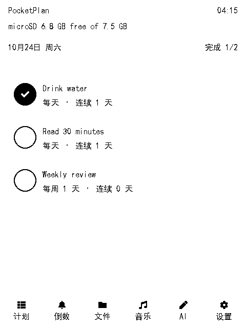
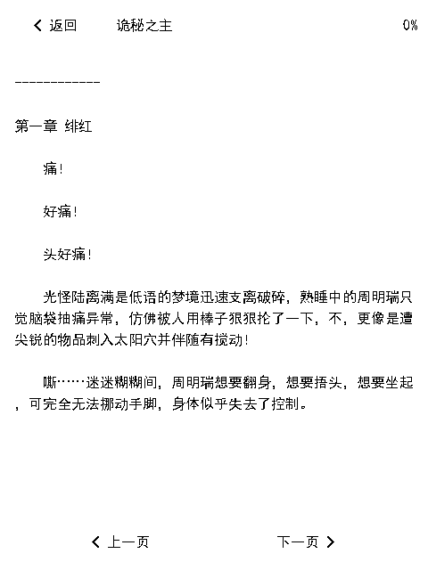
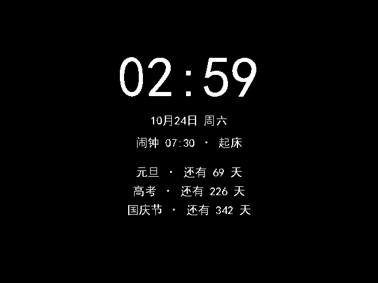
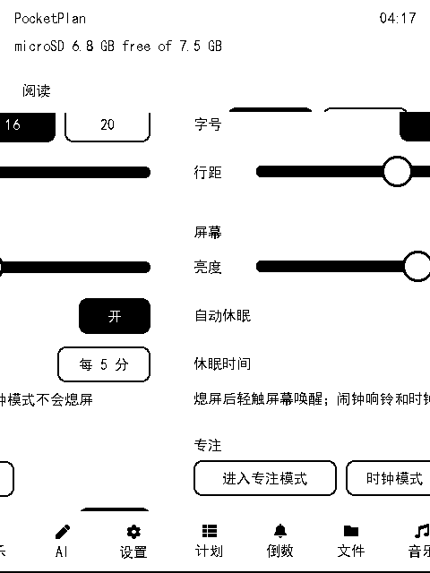

## 功能

| 模块 | 说明 |
|---|---|
| 计划打卡 | 每天/每周/一次性/间隔四种重复规则，连续天数与累计完成次数，勾选圈完成后是纯黑实心圆 + 白勾 |
| 倒数日 | 支持每年重复与一次性，自动算「还有 N 天 / 就是今天 / 已过 N 天」，可指定一条在专注模式/时钟模式下方显示 |
| 闹钟 | 网页端增删改，星期掩码，到点蜂鸣器「嘀嘀」+ 全屏浮层「停止」，响铃 60 秒自动停 |
| 阅读器 | 流式读取，支持 UTF-8 / GBK / UTF-16LE / UTF-16BE，14 MB 的单本小说实测可用；字号 16/20、行距可调、位置自动记忆 |
| 文件管理 | 浏览 TF 卡，文本类文件点开即读，24 条一页避免 LVGL 建行过慢 |
| 音乐 | 扫描 `/sdcard/music` 下的 mp3 列表（异步加载，先显示「读取中」），音频输出等 PCM5102A 焊上后启用 |
| AI 对话 | DeepSeek 兼容接口，Key 在网页端填；对话历史存在设备上，可清空 |
| 专注模式 | 横屏全屏时钟 + 已专注计时，轻触退出 |
| 时钟模式 | 横屏全屏：时间、日期、下一个闹钟、倒数日，轻触 3 下退出 |
| 自动休眠 | 无操作 N 分钟自动关背光，轻触唤醒；闹钟响铃和时钟模式期间不熄屏 |
| 网页端 | 设备自带单页应用（内嵌在固件里，约 34 KB）：计划、打卡、倒数日、闹钟、文件上传、AI、设置 |
| WebDAV | 同一个 80 端口上提供 WebDAV，Windows 资源管理器 / macOS Finder 可以直接挂载读写 TF 卡；**默认关闭**，在设备设置页「网络 → 网页映射」或网页「设置」里打开（没有认证，同网段谁都能读写，所以默认不开） |
| 配网 | 首次开机是热点 `PocketPlan-XXXX`（密码 `pocketplan`），网页里填 SSID/密码即可连家里的网；长按 BOOT 3 秒清除凭据 |

界面截图都在 [`pocketplan/docs/screenshots`](pocketplan/docs/screenshots)（01–21），下面是其中 12 张真机照片：

| 计划打卡 | 阅读器 | 倒数日 + 闹钟 |
|---|---|---|
|  |  | 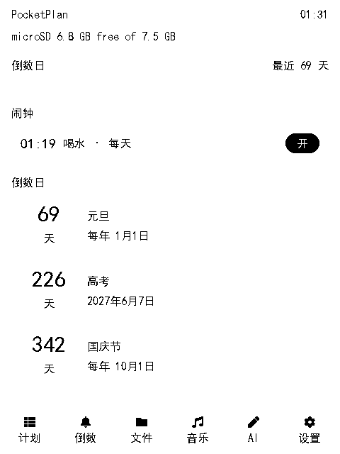 |
| **音乐列表** | **AI + 键盘** | **设置** |
| 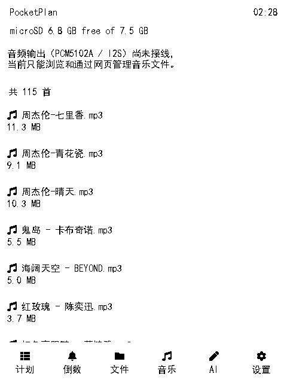 | 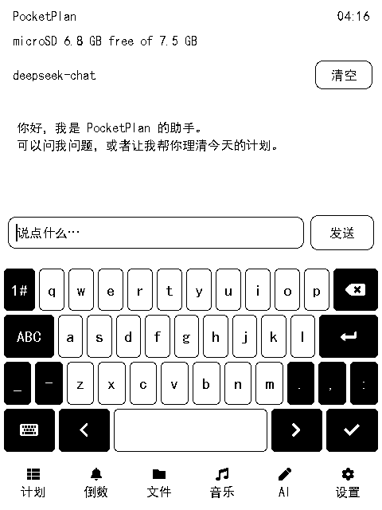 |  |
| **时钟模式（暗）** | **闹钟响铃** | **专注模式** |
|  | 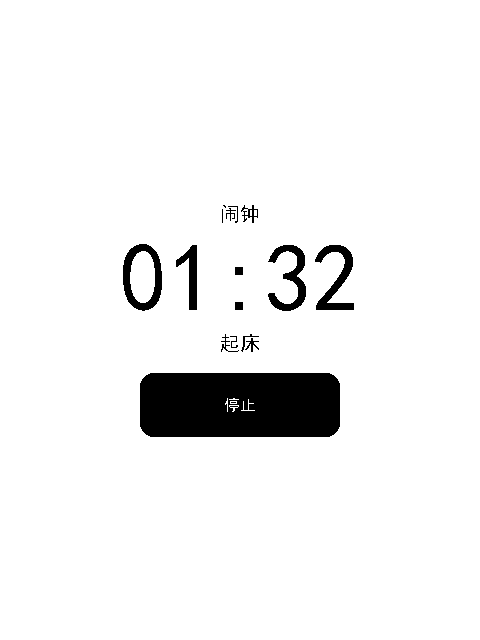 | 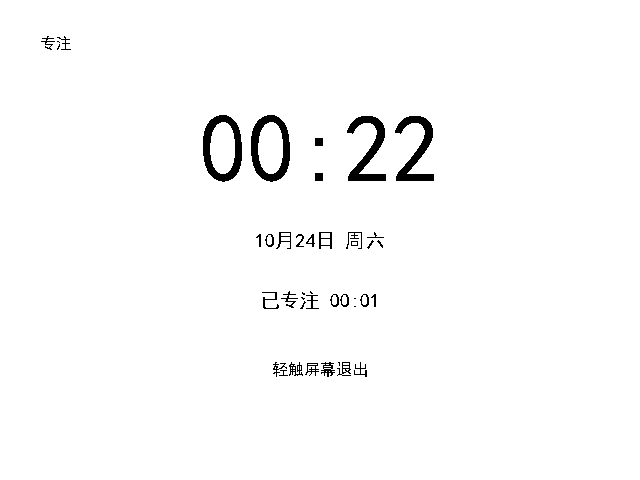 |
| **网页映射开关（默认关）** | **音乐异步加载** | **设置页滑块** |
| 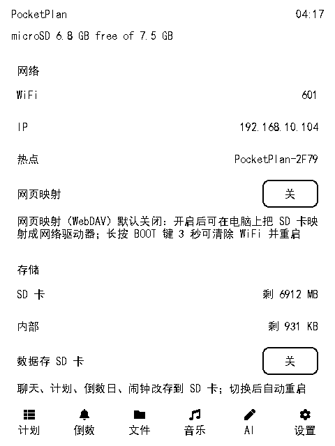 | 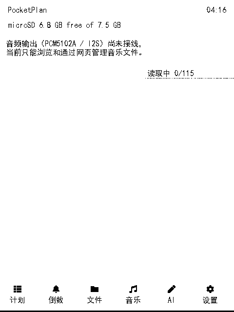 |  |

## 硬件

| 项 | 值 |
|---|---|
| MCU | ESP32-S3（16 MB Flash / 8 MB PSRAM） |
| 屏 | ST7701S，480×640 RGB565，30 MHz PCLK，背光 GPIO6（LEDC 20 kHz） |
| 触摸 | GT911，I2C 0x5D（SDA 15 / SCL 7 / INT 16） |
| 扩展 IO | TCA9554 0x20：LCD RST、TP RST、LCD CS、SD CS、IMU INT1/2、RTC INT、蜂鸣器 P7 |
| RTC | PCF85063 0x51，带纽扣电池，时间掉电不丢 |
| IMU | QMI8658（本固件暂未使用） |
| 存储 | TF 卡（SDMMC 1-bit：CLK 2 / CMD 1 / D0 42），板载 SPIFFS 1 MB 存配置 |
| 音频 | PCM5102A / I2S 预留 GPIO43/44/4，**尚未焊接**，所以音乐页目前只列表不播放 |

引脚全表见 [`PORT-REPORT.md`](PORT-REPORT.md)，踩坑记录（显示链路、横屏、字体、内存）也在那里。

## 编译

前置：

- **ESP-IDF v6.1**（v5.x 没试过，API 差异不少：本工程用的是 `driver/i2c_master.h` 新驱动、`esp_lcd` v2 面板接口）
- Python 3.11+、Git、以及一个能跑通 `idf.py` 的 shell

```bash
git clone https://github.com/<you>/PocketPlan.git
cd PocketPlan/pocketplan
idf.py set-target esp32s3     # 首次
idf.py build
```

在 Windows 上有一个额外坑：如果系统里存在全局 `MSYSTEM`（装了 Git for Windows 常见），ESP-IDF 的 `activate.py` 会报 *MSys/Mingw is not supported*。仓库里的 `tools/pp_build.ps1` 就是为这件事写的包装脚本：

```powershell
powershell -NoProfile -ExecutionPolicy Bypass -File tools/pp_build.ps1 -Command "idf.py build" -Log build.log
```

它做三件事：清掉 `MSYSTEM`、设好 `IDF_PATH`/`IDF_TOOLS_PATH`、用 `activate.py --export` 导入环境。把脚本顶部的 `IDF_PATH` 改成你自己的 ESP-IDF 路径即可。

字体是预生成的 C 数组（`pocketplan/main/fonts/pp_font_*.c`，共约 14 MB，含 21,318 个汉字字形），**不用**为了编译而安装 `lv_font_conv`。要改字号/增删字符集，见 [`.fontgen/gen2.sh`](.fontgen/gen2.sh)。

## 烧录

分区表 `pocketplan/partitions.csv`：`nvs` + `otadata` + `phy_init` + `ota_0`(0x3F0000) + `storage`(1 MB SPIFFS)。当前固件约 3.6 MB，占 88%。

```bash
cd pocketplan
idf.py -p COM5 flash        # 或 tools/pp_flash.ps1（只写分区表 + app，保留 NVS 里的配置）
```

`tools/pp_serial.ps1 -Port COM5 -Seconds 30` 是配套的串口抓日志脚本（Windows 下 `DtrEnable=false` 很关键，否则一开串口就把板子复位）。

## 首次使用

1. 插一张 **FAT32 / exFAT** 的 TF 卡（音乐放 `/music`，书随便放，文本类扩展名会被识别）。
2. 开机后设备开热点 `PocketPlan-XXXX`，密码 `pocketplan`，连上后浏览器打开 <http://192.168.4.1/>。
3. 网页「设置」里填家里的 WiFi，设备会自动切到 STA 模式；之后在路由器里看它的 IP，或看设备「设置 → 网络」页。
4. 同一网段访问 `http://<设备IP>/` 是控制台，`http://<设备IP>/` 也是 WebDAV 根（Windows：映射网络驱动器填 `http://<设备IP>/`）。
5. AI 对话需要自己填 DeepSeek（或任何 OpenAI 兼容）的 Base URL 和 Key。

## 目录结构

```
PocketPlan/
├─ pocketplan/              固件工程（idf.py 在这里跑）
│  ├─ main/                 26 个 .c + 4 个字体 .c
│  │  ├─ app_main.c         启动顺序（有讲究，见文件头注释）
│  │  ├─ board.c            ST7701S / GT911 / TCA9554 / SD / 背光 / 蜂鸣器
│  │  ├─ ui.c  page_*.c     5 个 tab + 阅读器 overlay
│  │  ├─ reader.c           GBK/UTF-16 流式阅读器
│  │  ├─ plans.c  countdowns.c  alarms.c   数据层（JSON + 互斥锁）
│  │  ├─ webapi.c  webdav.c  REST API 与 WebDAV
│  │  ├─ autosleep.c        自动休眠
│  │  └─ www/index.html     内嵌网页（BINARY embed）
│  ├─ partitions.csv  sdkconfig  sdkconfig.defaults
│  └─ docs/screenshots/     真机截图
├─ tools/                   构建 / 烧录 / 串口脚本
├─ .fontgen/                字体生成脚本（lv_font_conv）
├─ PLAN-BOARD-DESIGN.md     设计文档
├─ PocketPlan-项目进度.md    实现日志：每个里程碑做了什么、怎么验证、踩了哪些坑
├─ PORT-REPORT.md           板级硬件与显示链路笔记
└─ SD-REPORT.md             TF 卡相关笔记
```

## REST API（节选）

所有接口都在 80 端口，返回 JSON。

| 方法 | 路径 | 说明 |
|---|---|---|
| GET | `/api/status` | 内存 / SD / WiFi / 时间 / 闹钟状态 / 是否休眠 |
| GET POST | `/api/plans` | 计划列表 / 新增或修改（`id` 存在即更新） |
| DELETE | `/api/plans?id=` | 删除计划 |
| POST | `/api/checkin` | `{"id":"p1","done":true,"date":"2026-10-24"}` 打卡 |
| GET POST DELETE | `/api/countdowns` | 倒数日 |
| GET POST DELETE | `/api/alarms` | 闹钟；另有 `POST /api/alarms/stop` |
| GET POST | `/api/config` | 设置（AI、字号、亮度、专注、休眠、数据位置） |
| GET | `/api/files?path=/music` | 列目录 |
| POST | `/api/wifi` | `{"ssid":"...","password":"..."}` |
| GET POST | `/api/ai` | 取历史 / 发一条消息 |

## 已知限制

- **没有经典蓝牙**（ESP32-S3 只有 BLE），**没有麦克风、没有喇叭**；音频输出要自己焊 PCM5102A 才出声。
- 蜂鸣器接在 TCA9554 的 P7 上，只能开/关，**做不出音调**，闹钟就是「嘀嘀」。
- 屏幕按 1-bit 纯黑白使用：灰色在 1bpp 点阵与截图上会直接消失，所以 UI 里所有层次都用纯黑描边或反白表达。
- 音乐页 115 首时建行约 0.7–1.5 s（LVGL 建对象成本），列表上限 200 首。
- 自动休眠只关背光，不进入 light sleep，WiFi 与闹钟照常工作（换来的是「一碰就亮」）。
- 中文字体是 1bpp 点阵，只有一档字重；20 px 是阅读大字号，再大就要重新生成字体。

## 许可

MIT，见 [LICENSE](LICENSE)。第三方组件（ESP-IDF、LVGL、esp_lvgl_port、cJSON、各 esp_lcd 驱动）遵循各自许可证；字体由 SimHei 用 `lv_font_conv` 转成 1bpp 点阵，请自行确认字体授权后再分发。

## 致谢

- [LVGL](https://lvgl.io/) 与 [esp_lvgl_port](https://github.com/espressif/esp-bsp)
- Waveshare 的 ESP32-S3-Touch-LCD-2.8B 原理图与示例
- 以及这一路上被撞过的每一个坑，都写在 [`PocketPlan-项目进度.md`](PocketPlan-项目进度.md) 的「踩过的坑」一节里（54 条）。
